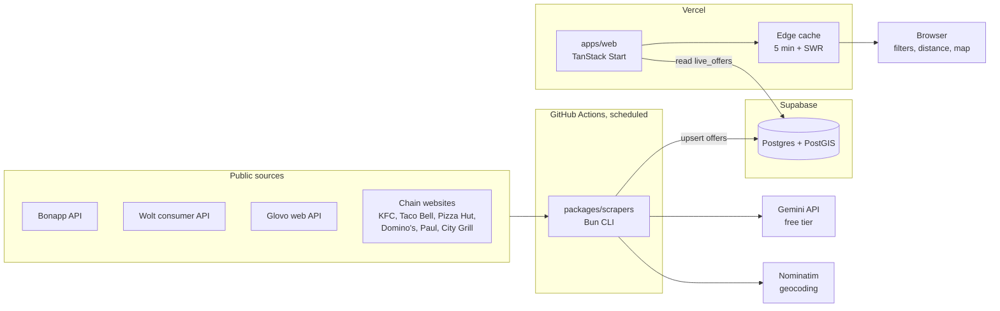

# Architecture

fentez foamea has three deployables that share one Postgres database. Scrapers write offers, the website reads them, and nothing else talks to the database.



| Deployable | Runs on | Job |
|---|---|---|
| `packages/scrapers` | GitHub Actions cron | Fetch offers, normalise them, write to Postgres |
| Postgres | Supabase free tier | Venues, offers, run log, caches |
| `apps/web` | Vercel | One page: list and map of live offers |

## Repository layout

```
apps/web             TanStack Start site (Vite, Nitro, React 19, Leaflet)
packages/core        Shared zod schemas, types, price/geo/time helpers, Romanian labels
packages/scrapers    Source implementations, pipeline, CLI
supabase/migrations  SQL schema, applied in filename order
docker-compose.yml   Local PostGIS that mimics Supabase's roles and extensions schema
vercel.json          Vercel service config for apps/web
turbo.json           build, check-types, test tasks across workspaces
```

Bun workspaces manage dependencies, with a catalog for shared versions (zod, TypeScript, vitest). Turborepo runs tasks across packages.

## Data model

Two migrations define everything: `20261021000000_init.sql` and `20261021120000_offer_schedule.sql`.

### Tables

**venues.** One row per place per source, unique on `(source, source_venue_id)`. Holds name, address, chain, link, a `location geography(point)` with a GiST index, and a `match_key` (normalised name plus coordinates rounded to 3 decimals) for spotting the same restaurant across sources later.

**offers.** One row per offer per source, unique on `(source, source_offer_id)`.

- `kind` is an enum: `surplus`, `discount`, `combo`, `daily_menu`, `happy_hour`, `coupon`.
- `price_ron` and `original_price_ron`. `discount_pct` is a generated column, computed only when the original price is higher.
- Time fields cover three shapes of offer. `starts_at`/`ends_at` for validity periods, `pickup_start`/`pickup_end` for surplus bags, and `days_of_week` (ISO 1 to 7) with `time_start`/`time_end` for weekday deals and lunch hours.
- `conditions` holds restrictions in plain Romanian, such as a minimum basket or "doar în restaurant".
- `delivery_only`, `available_count`, `url` (the link-back), `raw jsonb`.
- `active`, `first_seen_at`, `last_seen_at` track lifecycle.
- `venue_id` is nullable. A null venue means a national offer that applies everywhere.

**scrape_runs.** One row per source per run: status (`running`, `ok`, `failed`), offers seen and rejected, error text.

**geocode_cache.** Address to coordinates, including misses, so each address goes to Nominatim once.

**llm_cache.** Gemini results keyed by a SHA-256 of model, venue and content.

### Read side

`live_offers` is a view joining offers to venues. It keeps active offers whose `ends_at` and `pickup_end` are still in the future and whose `starts_at` is at most 7 days away, and exposes lat/lon as plain numbers.

`offers_near(lat, lon, radius_m, kinds, include_delivery, max_rows)` returns live offers within a radius, ordered by distance, with national offers last. The site does not use it yet; it exists for an API or alerts.

Row level security is on for every table. `anon` and `authenticated` can only `select` venues, offers and scrape runs. The two cache tables are not readable by them at all. Writes happen only through the scrapers' direct connection.

## Scrape pipeline

Every source implements one interface:

```ts
type Source = {
  id: SourceId;
  description: string;
  scrape: (ctx: SourceContext) => AsyncIterable<ScrapedOffer>;
};
```

`SourceContext` gives each source a shared HTTP client, a logger, the geocoder, an optional Gemini extractor and an optional `limit`. Sources yield offers one at a time, and `runSource` in `pipeline.ts` handles everything after that:

1. Open a `scrape_runs` row.
2. Validate each offer against the zod schema in `packages/core`. Invalid offers are counted as rejected and logged with the first three issues.
3. Skip duplicates within the run by `source_offer_id`.
4. If the venue has an address but no coordinates, geocode it through Nominatim, bounded to Bucharest and cached in `geocode_cache`.
5. Drop venues outside the Bucharest bounding box (44.33 to 44.55 N, 25.96 to 26.26 E).
6. Upsert the venue (cached per run), then upsert the offer, setting `active = true` and `last_seen_at = now()`.
7. On a successful full run, mark this source's offers not seen since the run started as inactive. Runs with `--limit` or a failure never deactivate anything, so a partial run cannot wipe the map. Sources that visit only part of their venues per run (Wolt, Glovo items) declare a `rotating` rule, and offers matching it stay active for 36 to 48 hours after they were last seen.
8. Close the run row. After all sources finish, delete inactive offers and run rows older than 30 days.

The CLI (`bun run scrape [sources...] [--dry-run] [--limit N] [--list]`) runs sources in sequence and exits non-zero if any failed. Dry runs skip the database and print validated offers as JSON lines.

### Politeness

- `PoliteHttp` keeps a separate queue per host and waits at least 1.5 seconds between requests to the same host.
- Retries happen only on 429, 500, 502, 503 and 504, up to three attempts, honouring `Retry-After` or backing off exponentially from 4 seconds.
- The user agent is `fentezfoamea-bot/0.1 (+<SCRAPER_CONTACT>)`.
- No source logs in, solves CAPTCHAs, passes bot challenges or uses anything extracted from a mobile app. Sites behind a challenge were skipped during recon.

## Sources

| Source | Data path | Emits | State |
|---|---|---|---|
| bonapp | `GET api.service.munch.eco/v1/products`, 20 km around the centre, 100 per page | One `surplus` offer per bag, with pickup window, stock and coordinates | Live |
| wolt | Venue lists on a 7 km grid, then `/dynamic` per venue for campaigns, then the assortment for item prices. 600 venues per run, rotating every 4 hours | Campaign offers plus up to 5 discounted items per venue, `deliveryOnly` | Live |
| glovo | Store wall POSTs from 5 points, `/v3/stores/{id}` for address and minimum basket, the Promoții deep link for item prices. Addresses and items rotate by day | Store promos plus up to 5 discounted items for 150 stores per run, `deliveryOnly` | Live |
| kfc | SvelteKit `__data.json` for offers and restaurants (devalue format) | One offer per deal per Bucharest restaurant, or per participating restaurant | Live |
| tacobell | SvelteKit `__data.json`, plus the `?/loadMore` form action for paged lists. Coordinates from Google Maps URLs | One offer per deal per Bucharest restaurant | Live |
| pizzahut | Open JSON: `getProductsAndCategoryByCategoryId?categoryId=2` and `getLocations` | One offer per deal per Bucharest restaurant | Live |
| dominos | Static HTML deals and store list, store addresses geocoded | One offer per deal per store | Live |
| paul | Offer listing and detail pages, store locator XML with coordinates | Offers per bakery; deals naming one bakery go to that bakery only | Live |
| citygrill | Promo pages on citygrill.ro, carucubere.ro and hanuberarilor.ro, lunch-menu PDFs through Gemini when a key is set | `daily_menu`, `combo`, `discount` and `happy_hour` offers at 7 restaurants | Live |

Shared parsing lives in `src/romanian.ts`: weekday lists and ranges ("de luni până joi", "marțea"), the price next to "lei", Romanian date ranges and "până la" end dates, daily time windows, and conditions such as "nu se aplică la livrare" or click and collect.

Notes on the bigger sources:

**Bonapp** and Munch share one platform. The products endpoint needs no auth. Prices come in bani and are divided by 100. Pickup windows like "17:00 - 19:00" plus a date become UTC timestamps through a Europe/Bucharest offset helper. Images and full descriptions are not stored.

**Wolt** returns about 1,400 venues per point and 2,000 to 3,000 across the city. Each run checks at most 650 venues for campaigns (`WOLT_MAX_VENUES`) and fetches at most 120 menus (`WOLT_MAX_ASSORTMENTS`). Platform-wide new-user campaigns and Wolt+-only campaigns are filtered out. Item prices come from joining campaign item ids with the menu and applying the campaign's fraction.

**Glovo** has no coordinates in its data, so store addresses go through the geocoder. Per run it does at most 300 address lookups and fetches menus for at most 150 promo stores, rotating which ones by date so coverage spreads over days. Prime-only promos and the first-order free delivery are ignored. Discounts are computed from the item price and the promo price, never from the label. The required `glovo-*` headers and app version are constants at the top of the file because Glovo can change them.

**Chains** publish national deals. Each deal is emitted once per Bucharest restaurant so it shows on the map near the user, and the site collapses the copies in the list.

### Gemini

`GeminiExtractor` wraps `@google/genai` for pages and PDFs that need text extraction, mainly City Grill's lunch menus.

- Model from `GEMINI_MODEL`, default `gemini-2.5-flash-lite`, chosen for its free-tier quota.
- A JSON response schema constrains output to the offer fields; temperature is 0.
- Requests are throttled to `GEMINI_RPM` (default 10 per minute).
- `GEMINI_DAILY_BUDGET` (default 200) caps calls per rolling 24 hours, counted from `llm_cache`.
- Results are cached by content hash, so an unchanged page or PDF is never sent twice.
- Without a key the extractor is `null` and sources fall back to what they can parse directly. Nothing breaks.

## Website

`apps/web` is a single route.

1. The `/` route loader calls `fetchOfferSnapshot`, a TanStack Start server function.
2. The server function reads up to 8,000 rows from `live_offers` plus the last successful run time, using `postgres` with one connection and prepared statements off (required by the Supabase transaction pooler).
3. Responses carry `CDN-Cache-Control: public, s-maxage=300, stale-while-revalidate=3600`, so Vercel's edge serves the page and the database sees roughly one query every 5 minutes regardless of traffic.
4. Everything else happens in the browser: dropping expired offers, computing distance from the user (or the city centre), filtering by kind, radius and delivery, and sorting by distance, discount or price.

The map uses Leaflet with OpenStreetMap tiles and loads lazily after hydration. Each venue is one pin showing its lowest price and offer count. Below zoom 16 pins shrink to dots so the city view stays readable; a selected venue keeps its price tag. Clicking a pin filters the list to that venue.

National chain deals appear once per store in the data. The list keeps the nearest copy and shows "și în alte N locații". Cards show the price tag, original price, discount, schedule (weekdays and hours), pickup window with a countdown in the last hour, conditions, and a link to the source.

## Key decisions

| Decision | Reason |
|---|---|
| Postgres on Supabase, not Convex | Convex's free tier meters function calls and bandwidth; scraping thousands of rows several times a day plus public reads would exceed it. Supabase meters storage. |
| GitHub Actions for scrapers, not Vercel cron | Vercel Hobby cron runs once a day. Surplus bags change by the hour, and Glovo or Wolt runs take up to about 25 minutes. Public repos get unlimited Actions minutes. |
| Edge-cached page, browser-side filtering | Bucharest has a few thousand offers. Shipping them once and filtering locally is simpler and cheaper than per-location queries. |
| Facts plus link-back, no photos or descriptions | Lower legal exposure under the sources' terms, and the source stays the place to buy. |
| "doar livrare" label on delivery offers | App menu prices can be marked up versus the restaurant, so a delivery discount is relative to the app price. |
| One offer row per chain store | Lets national deals show on the map near the user; the list collapses the copies. |
| Plain HTTP only, no browser automation | Recon found every useful source exposes JSON or static HTML. Playwright was dropped. |

## Known limitations

- Glovo's required headers and app version can change without notice and break that source until the constants are updated.
- Neither Glovo nor Wolt publish in-store prices, so the site cannot prove a delivery discount is real versus walking in.
- Glovo and Domino's addresses are geocoded through Nominatim, which misses some. 6 of 21 Domino's stores have no coordinates and show in the list without a distance.
- Pizza Hut picks the restaurant through a session cookie, so store-specific deals (like a 1+1 at one mall) are missed and every store gets the generic list.
- The City Grill group restaurants are a fixed list in code. Openings and closures need a code change.
- The same restaurant on Bonapp, Wolt and Glovo shows as separate venues. `match_key` is stored but not used yet.
- Blocking from GitHub Actions datacenter IPs has not been tested for any source.
- Most small restaurants post daily menus only on Instagram or Facebook, which this project does not scrape.
- Bonapp, Wolt and Glovo terms restrict reuse without consent. The maintainer is asking for permission.

## Next steps

- Run one scrape from GitHub Actions to confirm none of the sites block its IPs.
- Add a seasonal Bucharest Food Week source for May 2027.
- Merge duplicate venues across sources using `match_key`.
- Alerts ("bags near me in the next 2 hours") using `offers_near`.
